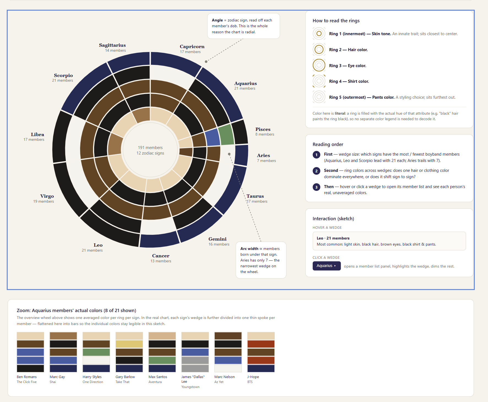

# Assignment 3 - Boy bands

### Visualization question
My visualization explores whether there's any trend in hair, eye, skin, shirt and pants colors across the twelve zodiac signs (derived from dob) - or whether boyband styling stays roughly the same no matter the sign.
The most important data attributes are dob (zodiac sign derived), hair_color, eyes, skin, shirt_color, bottom_color 
The reader should first notice which colors are most prominent for each zodiac sign, and how similar or different that mix is from sign to sign 
The reader should then be able to explore the exact color split behind any ring, and what the individual boyband members of each sign actually look like. 

### Marks and channels
| Data attribute | Mark | Channel | Why? |
|----------------|------|---------|------|
| Zodiac sign (derived from dob) | wedge (annular sector) | Angle, position around the circle | creates the actual zodiac-wheel structure; angle is the reason this chart is radial at all |
| Members born under each | wedge | Arc width - angular span | Makes the arc datadriven rather than decorative: Aquarius/Leo/Scorpio (21 members each) read visibly wider than Aries (7).  |
| Hair, eye, skin, shirt & pants color | Ring segment (5 concentric rings per wedge) | Radius (which ring) + Color (literal hue) | One ring per attribute color needs no decoding because the data value already is the color |

### Wireframe 
 

### Reflection

**What question or insight did your visualization communicate?**
My visualization explores whether there's any trend in hair, eye, skin, shirt and pants colors across the twelve zodiac signs. What it actually shows, once you look at it, is that most signs land on roughly the same answer — black hair, brown eyes, navy blue or black clothing — so the zodiac sign doesn't really predict much on its own. The more interesting pattern turns out to be how few boyband members really break from that "uniform," no matter which sign they're born under.

**Which marks did you choose, and why?**
I used two marks, and they're both arcs: the twelve wedges that make up the zodiac wheel, and the five ring segments stacked inside each wedge. Keeping everything as one mark type, drawn with d3.arc(), is what makes the whole thing feel like one coherent chart instead of a wedge chart with some other widget bolted on.

**Which channels did you choose, and why?**
I used three channels. Angle places each zodiac sign around the circle, which is the whole reason this chart is radial. Arc width encodes how many boyband members were actually born under that sign, so the wedges aren't just equal calendar slices — a sign like Aquarius with 21 members reads visibly wider than Aries with only 7. And radius plus color together encode the five attributes: radius tells you which attribute you're looking at, arranged roughly like a body from the feet up — pants closest to the center, hair at the outer rim — and color is literally the data value, so there's nothing to decode — a black ring just means "black."

**What does the arc structure represent in your design?**
The angle of a wedge is a calendar position, which zodiac sign it is, and its width is a count, how many members fall under that sign. Inside that wedge, the five rings are five different attributes about the same group of people, stacked roughly like a body: pants near the center, working up through shirt, skin and eyes, to hair at the outer edge.

**Which attributes from the dataset did you choose to visualize, and why?**
I used dob, turned into a zodiac sign, along with skin, hair_color, eyes, shirt_color and bottom_color. Those are exactly the attributes the visualization question needs — nothing more.

**Which attributes did you choose not to visualize, and why?**
I left out things like hair_style, facial_hair, accessories, instrument and height. None of them are part of the "zodiac versus color" question, and squeezing them in would mean more rings or marks competing for the same small wedges, without actually helping answer the question I set out to ask.

**What interaction did you implement, and how does it support the reader?**
I implemented two linked interactions. Hovering a ring shows the exact percentage split behind its color — for example that a shirt ring showing white is really "41% white, 18% black, 12% blue," and so on — instead of just the single dominant color. Clicking a wedge highlights that sign and opens a real member list below it, dimming the rest of the wheel. Together, they let the reader move from the big aggregate pattern down to the real, unaveraged people behind it.

**What would you improve if you had more time?**
A few zodiac signs only have 7 or 8 members, while others have 21, but right now their mode colors are drawn with exactly the same visual confidence. With more time I'd add a visible sample-size cue, like a lighter stroke or a slightly faded fill on the smaller wedges, so the reader doesn't read a 7-person pattern as being just as solid as a 21-person one.
